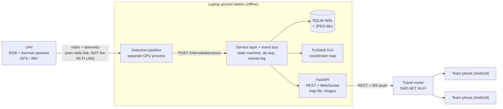

# SAR Manifest — Architecture Specification

Offline ground station + rescue-team mobile app for a UAV search-and-rescue FYP
(University of Moratuwa, "Multi-modal feature enhancement and object detection in
vision-denied environments"). This is the "live rescue manifest" from proposal
sections 1.8 and Chapter 4.

**One-line summary:** the laptop is the single source of truth. It runs the detection
pipeline, a local SQLite database and a FastAPI server on a private Wi-Fi LAN. Rescue
phones (Android) hold a live WebSocket to it, raise an alarm the moment a victim is
created, and keep working fully offline with a pre-loaded Sri Lanka map when they
walk out of Wi-Fi range.

---

## 1. Design rules

1. **Offline-first, no exceptions.** No cloud, no Firebase/FCM, no CDN scripts, no
   online map tiles, no Google fonts. Every byte (tiles, fonts, sprites, JS) is local.
2. **Server-authoritative, phone-tolerant.** The laptop decides every status change.
   Phones queue actions while out of range and sync when they return.
3. **Human in the loop.** The coordinator on the laptop sees everything, can verify or
   dismiss detections, and can override any assignment.
4. **Never lose an alert.** Every change is written to an ordered `events` log before
   it is pushed; reconnecting phones replay what they missed.

---

## 2. System overview



End-to-end flow for one victim:

1. UAV streams RGB + thermal frames and GPS/IMU to the laptop over its own radio link.
2. Pipeline enhances, fuses, detects, tracks; once a track is confirmed it computes the
   ground position and posts one detection to `/internal/detections`.
3. Service layer de-duplicates it (section 6). If new → victim created with status
   `open` (or `pending` in verify mode), images written, event logged.
4. Event pushed to every connected phone over WebSocket (siren + full-screen alert) and
   to the GUI (new red marker).
5. A team taps Accept → server checks it is still `open`, assigns it, every other phone
   hides it.
6. Team navigates with offline map + GPS, rescues, taps "Mark rescued" (queued if offline).
7. Laptop marks it `completed`, full history is logged.

---

## 3. Network

| Setting | Value |
| --- | --- |
| Access point | Battery-powered travel router (TP-Link TL-WR902AC / GL.iNet class). Laptop hotspot only as fallback. |
| SSID / security | `SAR-NET`, WPA2-PSK |
| Subnet | `192.168.50.0/24` |
| Laptop (server) | `192.168.50.10` (DHCP reservation or static) |
| Server port | `8000` HTTP for prototype (setting `server_port`) |
| Laptop ↔ router | Ethernet if possible |
| Windows | Network profile = Private; inbound firewall rule for the port (installer adds it) |

- The UAV video/telemetry link must be a separate radio and never use SAR-NET.
- **Discovery:** (1) QR code on the laptop contains `{"server_url": "...", "pairing_token": "...", "ssid": "SAR-NET"}`;
  (2) phone stores the URL; (3) mDNS fallback: server advertises `_sarmanifest._tcp.local.`
  via Python `zeroconf`.
- **Android no-internet Wi-Fi trap:** Android may route traffic to mobile data when the
  Wi-Fi has no internet. The app must request the Wi-Fi network explicitly
  (`ConnectivityManager.requestNetwork` with `TRANSPORT_WIFI`, without `NET_CAPABILITY_INTERNET`)
  and call `bindProcessToNetwork` on it. Implemented in Kotlin in the app's `sar-native` Expo module.
- Teams **will** leave Wi-Fi range. Everything on the phone must keep working offline.

---

## 4. Ground station (laptop)

### 4.1 Processes and threads

| Unit | Runs as | Job |
| --- | --- | --- |
| Detection pipeline | Separate OS process (GPU), separate codebase | Enhancement, RGB-thermal fusion, YOLO, tracking, geolocation. Emits confirmed detections only. |
| Qt GUI | Main thread of the manifest process | Map, manifest list, detail panel, teams, server status |
| API + WebSocket server | Uvicorn in a background thread with its own asyncio loop | REST, WS push, map file + image serving |
| Telemetry reader | Background thread | UAV pose via `pymavlink` (MAVLink) or `pynmea2` (NMEA) |
| Event bus | In-process pub/sub | DB write → event row → fan out to WS hub + Qt signal |

Rules:
- Never touch Qt widgets from the server thread. Emit a Qt signal from the bus; Qt queues
  it onto the GUI thread.
- Each thread uses its own SQLite connection. All SQL lives in `db/repo.py`.
- The GUI calls the service layer directly (Python), not over HTTP.
- The pipeline hands off via `POST http://127.0.0.1:<port>/internal/detections`
  (localhost-only). A `tools/mock_feed.py` script must emulate the pipeline.

### 4.2 Repository layout

```
ground_station/
  app.py                  # entry: init data dir + DB, start server thread, start Qt
  config.py               # paths (%LOCALAPPDATA%/SARManifest), settings loader
  core/
    models.py             # Pydantic schemas for API + internal DTOs
    state_machine.py      # allowed transitions (section 5)
    dedup.py              # detection -> victim merging (section 6)
    geo.py                # haversine, bearing, weighted position update
    events.py             # event bus + event type constants
    services.py           # VictimService, TeamService, DeviceService, MissionService
  db/
    schema.sql            # copy of docs/schema.sql
    connection.py         # PRAGMAs, per-thread connections
    repo.py               # all SQL
    migrations/
  api/
    server.py             # FastAPI app factory, uvicorn thread runner
    auth.py               # pairing, bearer tokens (SHA-256 stored)
    routes_mobile.py      # /api/v1/*
    routes_internal.py    # /internal/* (reject non-127.0.0.1 clients)
    routes_maps.py        # /maps/* with HTTP Range
    ws_hub.py             # connections, per-team filtering, replay, ping
  telemetry/
    mavlink_reader.py
    nmea_reader.py
  ui/
    main_window.py
    map_view.py           # QWebEngineView + QWebChannel bridge
    web/                  # map.html, maplibre-gl.js/.css, pmtiles.js, style.json, glyphs/, sprites/
    manifest_panel.py     # victim list
    detail_panel.py
    teams_panel.py
    pairing_dialog.py     # QR code (qrcode lib)
    settings_dialog.py
  tests/
tools/
  mock_feed.py            # replays images with fake GPS to /internal/detections
  build_map.md            # how to build srilanka.pmtiles
packaging/
  ground_station.spec     # PyInstaller one-folder
  installer.iss           # Inno Setup: install, firewall rule, shortcuts
```

Runtime data directory: `%LOCALAPPDATA%\SARManifest\`

```
manifest.db
maps/srilanka.pmtiles
images/<mission_id>/<detection_id>_frame.jpg   # full frame
images/<mission_id>/<detection_id>_crop.jpg    # person crop with margin
images/<mission_id>/<detection_id>_thumb.jpg   # 320 px long side, ~20-40 KB, sent to phones
logs/
```

### 4.3 GUI

- **Map (centre):** victims by status colour (red open, amber ongoing, green completed,
  grey dismissed, purple-outline pending), uncertainty circle = `position_error_m`; all teams
  with 15-min breadcrumb trail, greyed when silent > `team_stale_after_s`; UAV position + heading.
- **Manifest (left):** sortable table: display code, status, age, team, sightings, confidence.
  Click → zoom map + open detail.
- **Detail (right):** best crop + full frame (RGB/thermal), confidence, coordinates (copy button),
  error, status history, alert receipts ("5 of 6 delivered, 3 opened"). Actions: Verify (pending→open),
  Dismiss, Reassign to team, Reopen, Release, Add note.
- **Teams panel:** online/offline, battery, last seen, current assignment, revoke device.
- **Top bar:** server URL, connected devices, Pair device (QR), mission start/stop,
  alert mode toggle (`auto` / `verify`), laptop battery warning at 20%.
- **Manual victim:** right-click map → "Add victim here" (source = `manual`).

### 4.4 Map widget (laptop)

MapLibre GL JS + the `pmtiles` JS protocol, loaded from local files in `ui/web/`.
Style source URL: `pmtiles://http://127.0.0.1:<port>/maps/srilanka.pmtiles`.
Glyphs and sprites served from `/maps/glyphs/{fontstack}/{range}.pbf` and `/maps/sprites/...`.
Victims, teams, UAV = GeoJSON sources updated from Python via `QWebChannel`
(`bridge.updateVictims(geojson)`, etc.); clicks come back via `bridge.onVictimClicked(id)`.

### 4.5 Packaging

- PyInstaller **one-folder** mode (QtWebEngine resources unpack slowly in one-file mode).
- Inno Setup installer: creates data dir, firewall rule
  (`netsh advfirewall firewall add rule name="SAR Manifest" dir=in action=allow protocol=TCP localport=8000 profile=private`),
  desktop shortcut.
- Do NOT bundle PyTorch/CUDA in this exe. The detection pipeline is a separate program.

---

## 5. Victim state machine

Statuses: `pending` (verify mode only, never sent to phones), `open`, `ongoing`, `completed`, `dismissed`.
Teams only ever see `open`, `ongoing`, `completed`.

| From | To | Who | API / action | Guard |
| --- | --- | --- | --- | --- |
| (new) | open | system | dedup creates victim, `alert_mode = auto` | |
| (new) | pending | system | dedup creates victim, `alert_mode = verify` | |
| pending | open | coordinator | Verify | |
| pending / open | dismissed | coordinator | Dismiss (false alarm) | |
| open | ongoing | team | `POST /victims/{id}/accept` | `status = 'open'` (first wins) |
| ongoing | open | assigned team | `POST /victims/{id}/release` | `assigned_team_id = caller` |
| ongoing | open / ongoing(other team) | coordinator | Release / Reassign | |
| ongoing | completed | assigned team | `POST /victims/{id}/complete` | `assigned_team_id = caller` |
| ongoing | completed | coordinator | Mark completed | |
| completed | ongoing | coordinator | Reopen | |
| dismissed | open | coordinator | Restore | |

Anything else → HTTP 409 `invalid_transition`. Every attempt (applied or rejected) is
written to `status_history`; every applied change writes one `events` row.

**Claim race — always a single conditional UPDATE, never read-then-write:**

```sql
UPDATE victims
   SET status = 'ongoing', assigned_team_id = :team_id,
       accepted_at = :now, updated_at = :now, version = version + 1
 WHERE id = :victim_id AND status = 'open';
-- rowcount 1 -> won: event victim.updated (scope team) + victim.hidden (to other teams)
-- rowcount 0 -> 409 {"error":"already_claimed","team":{"id":...,"name":...}}
```

Complete / release use `WHERE id = :id AND status = 'ongoing' AND assigned_team_id = :team_id`.

**Idempotency:** every phone action carries `client_event_id` (UUID). If it already
exists in `status_history`, return the original outcome without re-applying.

---

## 6. De-duplication (one person → one alert)

For each incoming detection, in a single DB transaction:

1. **Confirmation gate (pipeline side):** pipeline only posts after the track has been held
   for several frames above its confidence threshold (ideally RGB + thermal agree).
2. **Same track:** if a detection with the same `(mission_id, track_id)` is already linked to a
   victim → attach.
3. **Nearby victim:** else find victims with status in (`pending`, `open`, `ongoing`) in this mission,
   `last_seen_at` within `dedup_window_min`, and haversine distance ≤
   `R = max(dedup_radius_min_m, dedup_error_multiplier × geo_error_m)` → attach to the nearest.
4. **Rescuer filter:** else if within `rescuer_radius_m` of any team's latest fix
   (`last_fix_at` within `team_stale_after_s`) → store detection with `near_rescuer = 1`,
   `victim_id = NULL`, emit laptop-only event `detection.near_rescuer`. No alert.
5. **New victim:** else create victim (`open` or `pending` by mission alert_mode),
   `display_code = 'V-' + zero-padded counter`, emit `victim.created`.

**Attach** = `sighting_count += 1`, `last_seen_at = frame_ts`, position update weighted by
`w = confidence / max(geo_error_m, 1)²`, recompute `position_error_m`, replace
`best_detection_id` if confidence higher, update `modalities`, emit `victim.updated`
(no siren). Bulk-bounding-box prefilter before haversine is enough; no spatial extension needed.

---

## 7. API

Base: `http://<laptop>:<port>`. JSON. Mobile routes need
`Authorization: Bearer <device_token>` (except `/pair` and `/health`).
Errors: `{"error": "<code>", "message": "...", ...}`.

### 7.1 Mobile REST (`/api/v1`)

| Method | Path | Request | Response |
| --- | --- | --- | --- |
| POST | `/pair` | `{pairing_token, device_label, team_id?, app_version, os_version}` | `{device_id, device_token, team:{id,name,call_sign,color_hex}, mission}` |
| GET | `/health` | – | `{server_time, version, mission:{id,name}|null}` |
| GET | `/me` | – | `{device, team, assignments:[victim]}` |
| GET | `/victims` | `?since_seq=` | `{victims:[Victim], last_seq}` (filtered by visibility) |
| GET | `/victims/{id}` | – | `{victim: Victim, history:[...]}` |
| GET | `/victims/{id}/image` | `?size=thumb` / `crop` / `frame` | `image/jpeg` |
| POST | `/victims/{id}/accept` | `{client_event_id, client_ts}` | 200 `{victim}` / 409 `already_claimed` |
| POST | `/victims/{id}/release` | `{client_event_id, client_ts, reason}` | 200 `{victim}` / 409 |
| POST | `/victims/{id}/complete` | `{client_event_id, client_ts, people_count, note}` | 200 `{victim}` / 409 |
| POST | `/locations` | `{points:[{client_point_id, lat, lon, accuracy_m, altitude_m, speed_mps, heading_deg, battery_pct, fix_ts}]}` | `{accepted, duplicates}` |
| POST | `/alerts/{victim_id}/receipt` | `{delivered_at?, opened_at?}` | 204 |
| GET | `/sync` | `?since_seq=N` | `{events:[Envelope], last_seq}` (max 500, page with since_seq) |

`Victim` (phone view):
```json
{
  "id": "uuid", "display_code": "V-0007", "status": "open",
  "lat": 7.2906, "lon": 80.6337, "position_error_m": 8.5,
  "max_confidence": 0.87, "modalities": "both", "sighting_count": 4,
  "first_detected_at": 1759642000000, "last_seen_at": 1759642060000,
  "assigned_team_id": null, "people_count": null,
  "thumb_url": "/api/v1/victims/uuid/image?size=thumb",
  "version": 3, "updated_seq": 1042
}
```

### 7.2 Map files

| Method | Path | Notes |
| --- | --- | --- |
| GET | `/maps/manifest` | `{file:"srilanka.pmtiles", size, sha256, style_version}` |
| GET | `/maps/srilanka.pmtiles` | Must support HTTP `Range` (206) — used by MapLibre GL JS and resumable phone download |
| GET | `/maps/style.json`, `/maps/glyphs/...`, `/maps/sprites/...` | Static |

### 7.3 Internal (127.0.0.1 only — reject any other client IP with 403)

`POST /internal/detections`
```json
{
  "mission_id": "uuid", "track_id": 12, "frame_ts": 1759642000000,
  "modality": "fused", "confidence": 0.87,
  "bbox": {"x": 512, "y": 300, "w": 24, "h": 40},
  "lat": 7.2906, "lon": 80.6337, "geo_error_m": 8.5,
  "uav": {"lat": 7.2910, "lon": 80.6330, "alt_agl_m": 60, "heading_deg": 135, "gimbal_pitch_deg": -90},
  "weather_tag": "rain",
  "images": {"frame_path": "C:/.../f.jpg", "thermal_crop_path": null}
}
```
Server crops `bbox` (+20% margin) to make crop and thumbnail, copies files into the images dir.
Also accept `"images": {"frame_b64": "..."}`. Response:
`{detection_id, victim_id, created_new_victim, near_rescuer}`.

`POST /internal/telemetry` — `{mission_id, ts, lat, lon, alt_msl_m, alt_agl_m, heading_deg, pitch_deg, roll_deg, gimbal_pitch_deg, ground_speed_mps, battery_pct}`;
store at most 1 Hz.

### 7.4 WebSocket `GET /ws?token=<device_token>&since_seq=<N>`

Envelope: `{"seq": 1042, "type": "victim.created", "ts": 1759642000000, "data": {...}}`

On connect: authenticate, replay all visible events with `seq > since_seq` in order,
then stream live. Server sends `{"type":"ping"}` every `ws_ping_interval_s`; client replies
`{"type":"pong"}`; close if silent for `ws_dead_after_s`.

| Dir | Type | Data / meaning |
| --- | --- | --- |
| S→P | `victim.created` | Victim. Triggers alarm. |
| S→P | `victim.updated` | Victim (status/position/notes changed, visible to this team) |
| S→P | `victim.hidden` | `{id, reason: "claimed" / "dismissed"}` — remove from map, cancel notification |
| S→P | `assignment.changed` | `{victim_id, team_id}` — coordinator reassignment |
| S→P | `ping` | keepalive |
| P→S | `ack` | `{seq}` → `devices.last_acked_seq` |
| P→S | `location` | single point (same fields as `/locations`) |
| P→S | `pong` | keepalive |

Laptop-only events (GUI via Qt signal, `events.laptop_only = 1`): `team.location`,
`device.online`, `device.offline`, `alert.receipt`, `detection.near_rescuer`, `uav.pose`.

### 7.5 Visibility rule (enforced server-side)

A team receives: all `open` victims + any victim whose `assigned_team_id` is that team.
It never receives `pending`/`dismissed` victims (except `victim.hidden`), other teams'
`ongoing`/`completed` victims, or any team/UAV positions. When a victim leaves a team's
visible set, that team gets `victim.hidden`.
*(Assumption — confirm with the team. Alternative: coordinator dispatches Open victims to a chosen team.)*

Target: `/internal/detections` → phone notification < 2 s on the LAN.

---

## 8. Offline maps (Sri Lanka)

- Format: **vector PMTiles**, OpenMapTiles schema, generated with Planetiler from OSM/Geofabrik:
  ```
  java -Xmx2g -jar planetiler.jar --download --area=sri-lanka --output=data/srilanka.pmtiles
  ```
  Build once on a machine with internet + Java 21; rebuild before field trials.
- Never bulk-download raster tiles from openstreetmap.org (violates tile usage policy).
- Bundle: `srilanka.pmtiles`, `style.json` (OpenMapTiles-compatible, e.g. OSM Bright/Positron,
  every remote URL replaced by local), `glyphs/` (font PBFs for every fontstack used in the style),
  `sprites/`. Missing glyphs = no labels.
- Verify with the network adapter disabled.
- Laptop: MapLibre GL JS + `pmtiles` protocol (section 4.4).
- Phone: MapLibre Native via `@maplibre/maplibre-react-native` (PMTiles supported natively on Android).
  The file must be stored **on the phone**: downloaded once at pairing from
  `/maps/srilanka.pmtiles` (resumable, checksum against `/maps/manifest`) or copied via USB.
  Style source: `pmtiles://file://<app_docs_dir>/srilanka.pmtiles`.
- GPS needs no network; start location updates when the mission starts (cold fix without
  A-GPS can be slow). Drop fixes worse than `gps_max_accuracy_m` from trails.

| Layer | Laptop | Phone |
| --- | --- | --- |
| Victims open | all, red | all, red, pulsing |
| Victims ongoing | all, amber + team label | own team only, amber |
| Victims completed / dismissed | green / grey (toggle) | own completed, green |
| Teams | all, team colour, 15-min trail, grey if stale | self only (blue dot + heading) |
| UAV | position, heading | – |
| Distance + bearing | on click | to selected victim, always (offline) |

No turn-by-turn routing in scope.

---

## 9. Mobile app (Android, React Native)

Android only (iOS cannot hold background sockets or receive offline pushes). Min Android 8.
Built with React Native 0.86 + Expo SDK 57 (dev client / local Gradle builds, no Expo cloud
services at runtime). *Changed from Flutter at the team's request; behaviour is unchanged.*

### 9.1 Packages

| Need | Package |
| --- | --- |
| Map + PMTiles | `@maplibre/maplibre-react-native` 11 (MapLibre Native Android 13, PMTiles built in) |
| Background socket | `sar-native` local Expo module: `SarForegroundService` (persistent "Connected to SAR base" notification, type location/dataSync) |
| WebSocket | React Native `WebSocket` (`src/core/ws.ts`: replay, ack, ping/pong, reconnect) |
| REST | `fetch` (`src/core/api.ts`) |
| Alarms | `sar-native` `Alarms.kt` (alarm channel, bundled siren, full-screen intent, Accept / View actions) |
| GPS | `expo-location` |
| Local DB | `expo-sqlite` |
| QR | `expo-camera` (bundled ML Kit barcode model, works offline) |
| Token storage | `expo-secure-store` |
| Compass | `expo-location` heading |
| Wi-Fi binding | `sar-native` `WifiBinder.kt` (section 3) |
| Map download + checksum | `sar-native` `Files.kt` (HTTP Range resume, SHA-256) |
| Navigation | `expo-router` |

Notifee was not used: it has had no release since 2024 and the alarm path is safety-critical.

### 9.2 Layout

```
mobile_app/
  app.json                       # Expo config + config plugins (cleartext LAN, min SDK 26, glyph assets)
  modules/sar-native/            # local Expo module (Kotlin): WifiBinder, SarForegroundService, Alarms, Files
    android/src/main/res/raw/siren.wav
  plugins/withMapGlyphs.js       # bundles assets/glyphs into the APK (asset://glyphs/...)
  src/
    app/         _layout, index, pairing, map, alert/[id], victim/[id], complete/[id], jobs   (screens)
    core/        types.ts, api.ts, ws.ts, geo.ts
    data/        repo.ts (interface), db.ts (expo-sqlite), memory.ts (tests)
    engine/      engine.ts, events.ts, outbox.ts, pairing.ts, mapStyle.ts, files.ts
    state/       store.ts
    ui/          theme.ts, components.tsx
  __tests__/     jest: events, outbox, ws, geo, style
```

### 9.3 Screens

1. **Pairing:** scan QR → bind Wi-Fi → `POST /pair` → choose team (if not in token) →
   download map with progress → test WS. Cannot finish without map + checksum OK.
2. **Map (home):** offline map, own dot, open + own victims; connection pill
   (green Live / amber Reconnecting / red "Offline – N queued").
3. **Alert (full-screen, over lock screen):** code, thumbnail, distance + bearing, confidence,
   age; buttons Accept / View on map. Siren repeats every `alert_repeat_s` until opened.
4. **Victim detail:** thumbnail (tap → full frame), coordinates (copy), compass arrow + distance,
   history; buttons by state: Accept (open) / Mark rescued + Release (ongoing, own team).
5. **Complete form:** people_count, note.
6. **My jobs:** own ongoing + completed.

### 9.4 Behaviour

- On `victim.created`: notification + vibration + siren → POST receipt `delivered_at`;
  on open → `opened_at`.
- On `victim.hidden`: remove marker, cancel notification.
- Ask for battery-optimisation exemption at setup.
- **Outbox:** every action → write outbox row → update UI optimistically → send. On reconnect:
  flush outbox in order → upload location buffer in one batch → `/sync` or WS replay from `last_seq`.
  On 409: roll back local state, show who has it.
- **Offline accept:** allowed locally, shown as "Accept pending – not confirmed by base";
  first to reach server wins.
- **Location:** connected → every 10 s or 20 m; offline → every 30 s into buffer. Include battery.

### 9.5 Phone local DB (expo-sqlite)

| Table | Columns |
| --- | --- |
| cached_victims | id PK, display_code, status, lat, lon, position_error_m, max_confidence, modalities, assigned_team_id, people_count, thumb_local_path, first_detected_at, updated_seq, local_pending_action, alerted_at, opened_at (siren repeat + receipts) |
| outbox | client_event_id PK, kind (accept/release/complete/receipt), victim_id, payload_json, client_ts, attempts, last_error, created_at |
| location_buffer | client_point_id PK, lat, lon, accuracy_m, altitude_m, speed_mps, heading_deg, battery_pct, fix_ts, uploaded |
| sync_state | id PK (=1), server_url, device_id, team_id, team_name, last_seq, map_sha256 |

---

## 10. Security

- Pairing tokens: one-time, expire after `pairing_token_ttl_min`. Device token: 32 random bytes,
  url-safe base64; store SHA-256 only. Revocation from Teams panel closes its WS.
- `/internal/*` → 403 unless client host is 127.0.0.1.
- HTTP OK on WPA2 LAN for prototype; HTTPS optional later (self-signed, fingerprint in QR).
- Mission "Close and archive": zip mission folder, optional image deletion (data governance).

## 11. Failure handling

| Failure | Expected behaviour |
| --- | --- |
| Laptop app crash/restart | WAL DB intact; phones reconnect with since_seq and replay |
| Phone out of range | map, GPS, actions work; outbox + GPS buffer sync on return |
| App killed / phone asleep | foreground service keeps WS; if killed, replay on next launch |
| False positive | coordinator dismisses → `victim.hidden` to all; verify mode keeps it off phones |
| Same person, many passes | de-dup (section 6) |
| Simultaneous accept | conditional UPDATE, one winner, other gets 409 |
| Wrong phone clock | server uses `server_ts`; `/health` returns server time for display offsets |

## 12. Acceptance tests (also evaluation results)

- [ ] Alert latency `/internal/detections` → phone notification, ≥ 50 alerts, median + p95 < 2 s
- [ ] Claim race: 2 phones × 20 trials → exactly one winner each time
- [ ] Missed-alert replay: Wi-Fi off, 5 victims created, Wi-Fi on → all 5 arrive in order
- [ ] Out-of-range rescue: complete offline → syncs once, no duplicate history row
- [ ] Airplane-mode map: full map, labels, own GPS position anywhere in Sri Lanka
- [ ] Laptop restart mid-mission: nothing lost, phones reconnect automatically
- [ ] De-dup: recorded flight with repeated passes → alerts ≈ true people count
- [ ] Rescuer filter: team under the drone triggers no alert
- [ ] Geolocation error (RQ4): known GPS points → mean + max error (m)
- [ ] Load: 10 phones, 100 victims → GUI responsive, latency target held
